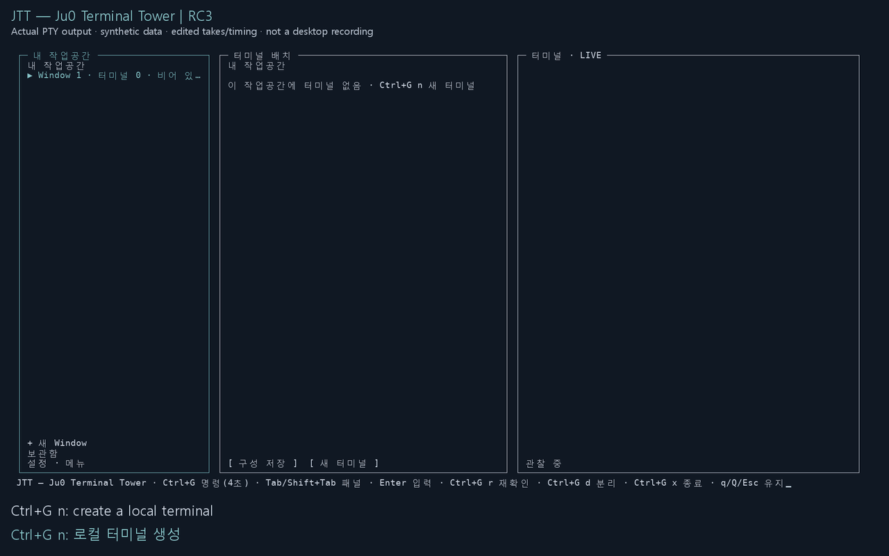

# JTT — Ju0 Terminal Tower

**[English](README.md) | 한국어**

**LEFT의 Window, CENTER의 터미널 카드, RIGHT의 실제 대화형 터미널**로 작업하는 로컬 터미널 작업공간입니다.

독립 셸을 만들고 전환하며, UI를 닫아도 실행을 유지하고 같은 세션에 재연결합니다. 클라우드 서버, 모델 API, Agent 계정 관리 또는 필수 tmux 서버는 없습니다.

기존 tmux Pane을 관찰하는 Legacy Tower와 달리 JTT는 자체 로컬 터미널을 유지합니다. 그 안에서 실행할 프로그램은 사용자가 선택합니다.

[공식 RC3 프리릴리스](https://github.com/ju0o/tmux-agent-tower/releases/tag/jtt-v0.3.0-rc3) · [빠른 시작](docs/JTT_QUICK_START.ko.md) · [75초 사용 영상](media/jtt-rc3-intro.mp4)

## 사용 흐름



생성 → RIGHT 입력 → 터미널 전환 → UI 분리 → 재연결.
실제 RC3 curses/PTY 출력을 렌더링한 **합성 데이터 기반 편집 시연**이며 Windows Terminal 창을 직접 녹화한 영상은 아닙니다. 시간 흐름을 편집했으며 성능 측정 자료가 아닙니다. Windows Terminal 네이티브 화면 검증은 아직 대기 상태입니다.

[영상·썸네일](docs/JTT_MEDIA.md) · [영문 자막](media/jtt-rc3-intro.en.srt) · [한국어 자막](media/jtt-rc3-intro.ko.srt) · [텍스트 설명·검증 범위](docs/JTT_MEDIA.md)

## 공식 RC3 설치

Linux / WSL2, pip·venv를 포함한 Python 3.9 이상, Git, UTF-8 터미널이 필요합니다.
새 `jtt-release` 폴더를 만들 수 있는 위치에서 실행하세요. 네트워크와 명시적 설치 확인이 필요하며 기존 `jtt` 명령은 덮어쓰지 않습니다.

```sh
if (
  set -eu
  JTT_TAG=jtt-v0.3.0-rc3
  JTT_REPO=https://github.com/ju0o/tmux-agent-tower.git
  if ! git ls-remote --exit-code --tags "$JTT_REPO" "refs/tags/$JTT_TAG" >/dev/null; then
    printf 'Cannot verify JTT tag %s (tag unavailable or network error); nothing installed.\n' "$JTT_TAG" >&2
    exit 1
  fi
  if ! git clone --branch "$JTT_TAG" --depth 1 "$JTT_REPO" jtt-release; then
    printf 'Clone failed; the installer was not run.\n' >&2
    exit 1
  fi
  cd jtt-release || exit 1
  ./scripts/jtt-install-release
); then
  :
else
  printf 'JTT installation did not complete; this shell remains open.\n' >&2
fi
```

필요하면 **현재 셸에만** 실행 경로를 추가하세요.

```sh
export PATH="$HOME/.local/bin:$PATH"
jtt --version
jtt doctor
jtt
```

버전 `0.3.0rc3`와 `OFFICIAL`을 확인하세요. 안정판이 아닌 **프리릴리스**입니다.
JTT의 `jtt-v0.3.0-rc3`는 기존 Tower `v0.3.0-rc2`와 다릅니다. 이미 공개된 RC3 아티팩트는 Legacy Tower와 패키지 메타데이터를 공유하지만, 이 소스 브랜치가 설치하는 콘솔 명령은 `jtt`뿐입니다. 과거 Tower 코드와 문서는 저장소에 보존하며 기존 Tower 설치는 변경하지 않습니다.
설치기는 공개 JTT Release·커밋·메타데이터·진입점을 검증하며 기존 `tower` 명령이나 셸 시작 파일을 변경하지 않습니다.
기존 설치는 [업데이트·롤백 안내](docs/JTT_UPDATING.ko.md)를 참고하세요.

## 첫 터미널

1. `jtt`를 엽니다. UI 실행만으로 셸이 생성되지 않습니다.
2. **Ctrl+G 다음 n**을 4초 안에 누릅니다. 새 터미널이 준비되면 입력 모드로 전환됩니다.
3. RIGHT에 `printf 'Hello JTT\n'`을 입력하고 Enter를 누릅니다.
4. **Ctrl+]**로 탐색에 복귀합니다. Tab / Shift+Tab으로 패널을 이동합니다.
5. **Ctrl+G d**로 UI를 분리합니다. 같은 상태 경로로 `jtt`를 다시 열면 재연결합니다.

| 기본 키 | 동작 |
| --- | --- |
| Ctrl+G n | 선택 Window에 새 터미널 |
| Ctrl+G h / l | 이전 / 다음 카드 |
| Ctrl+G w | LEFT 이동 |
| Ctrl+G x | 선택 터미널 종료 확인 |
| Ctrl+G d | UI 분리, 셸 유지 |
| Ctrl+G ? | 도움말 |
| Ctrl+] | 입력 → 탐색 |
| Ctrl+G Ctrl+G / Ctrl+G Ctrl+] | 입력 모드에서 예약 키 원문 전달 |

입력 모드의 일반 `q`, `n`, Tab, Esc는 터미널에 전달됩니다. 탐색 모드의 `q`는 종료하지 않습니다. Prefix 다음 Esc는 명령 대기를 취소합니다.
[빠른 시작](docs/JTT_QUICK_START.ko.md)에서 실제 메뉴명과 사용자 지정 키 주의사항을 확인하세요.

## 작업 정리

- **Window:** 논리 그룹이며 OS/tmux Window가 아닙니다. 생성만으로 셸을 실행하지 않습니다.
- **저장 작업공간:** 기존 세션 참조를 저장하며 신원이 일치할 때 재연결합니다. 재부팅 후 프로세스 복원 기능이 아닙니다.
- **Work Kit:** 편집 가능한 1~4개 카드 템플릿입니다. 미리보기·편집·저장은 터미널이나 명령을 실행하지 않습니다. RC3에는 Kit 실행 기능이 없습니다.
- 저장한 작업과 템플릿은 **보관함**의 별도 탭에 있습니다.

## 문서

- [빠른 시작](docs/JTT_QUICK_START.ko.md) · [English Quick Start](docs/JTT_QUICK_START.md)
- [터미널 호환성·키보드 정책·데이터 안전](docs/JTT_TERMINAL_SUPPORT.md)
- [Work Kit](docs/JTT_WORK_KITS.md) · [업데이트·롤백](docs/JTT_UPDATING.ko.md)
- [시연과 촬영 경계](docs/JTT_SHOWCASE.md) · [접근성용 미디어 설명](docs/JTT_MEDIA.md)
- [기존 Tower 설치·사용 안내](docs/TOWER_LEGACY.ko.md) · [Legacy Tower English](docs/TOWER_LEGACY.md)

개발 체크아웃의 **DEV** 설치는 `./scripts/jtt-setup-dev`, `./scripts/jtt-install-dev`를 명시적으로 실행합니다. 전용 환경에 의존성을 설치할 수 있지만 일반 시작 시 몰래 설치하지 않습니다. DEV에서는 공식 업데이트를 적용하지 않습니다.

JTT 셸은 사용자 권한이며 **샌드박스가 아닙니다**. pyte 렌더러는 제한된 VT 범위만 지원하며 모든 xterm/Agent TUI 호환성을 주장하지 않습니다. Clipboard와 실제 WSL 재시작 복구는 미검증입니다. JTT는 MIT, pyte는 LGPL-3.0, wcwidth는 MIT입니다. [의존성 고지](docs/JTT_TERMINAL_SUPPORT.md#renderer-dependency-and-license)와 [pyte 라이선스](licenses/pyte-LGPL-3.0.txt)를 참고하세요.
