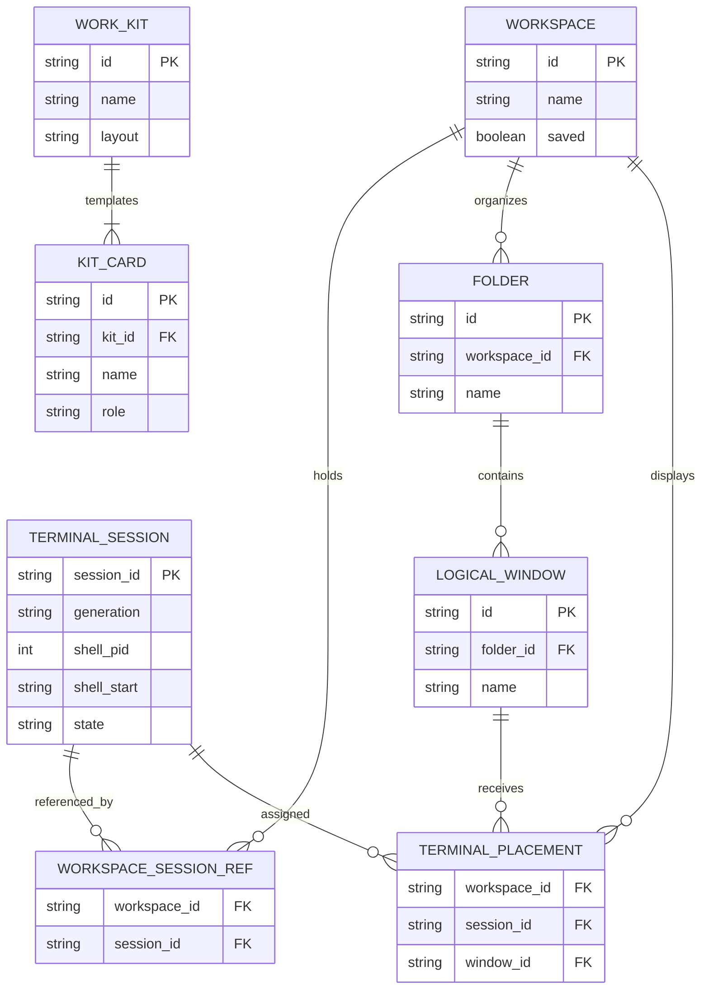
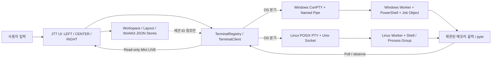

# JTT / Tmux-Agent-Tower — 최종 프로젝트 통합 문서

> 기준일: 2026-10-31 (KST) · 문서 목적: Notion 단일 페이지 이관 / 총괄 PM 인계 / 에이전트 릴레이
>
> **판정:** V1 Release **HOLD** · Windows IPC 통합 **46/46 PASS** · Windows 제품 R02 **FAIL** · SEMANTIC02 **INCONCLUSIVE**
>
> **증거 기준:** 공개 [ju0o/JTT](https://github.com/ju0o/JTT) `main=15a663cf787a2d865b6ebc69626304a50bed25e9`, [PR #40](https://github.com/ju0o/JTT/pull/40) HEAD `59f1a6b9849d699fd5f4e6870b023a11cadca33e`(Draft), [PR #39](https://github.com/ju0o/JTT/pull/39) Release WBS/지원 정책(Draft), 격리 실험 커밋 `74f8cde0095d278afc948646f8c95f106aa23ce8`, GitHub Actions 실행 증거. 코드와 PR의 병합 상태를 구분한다.
>
> **감사 범위와 한계:** 연결된 GitHub에서 접근 가능한 저장소 91개 목록을 확인하고 JTT 명시 저장소·관련 후보 Private 저장소의 교차 참조를 탐색했다. `ju0o/JTT`의 40개 PR 목록과 상태, 기본 브랜치 문서, PR #39 미병합 문서, 핵심 상태·터미널 코드를 조사했다. **모든 Private 저장소의 전체 파일/과거 채팅/비공개 의사결정까지 검증했다고 주장하지 않는다.** JTT 관련 확정 출처가 없는 타 제품 설계는 병합하지 않았다. 공식 JTT PRD·ERD·DBML 원본 파일은 확인되지 않아 아래 PRD는 기존 문서 기반 통합본, ERD는 **실제 JSON 파일을 해석한 논리 모델**이다. GitHub 단독 Issue는 조회 범위에서 확인되지 않았으며 PR은 Issue API에도 나타난다.

---

## 1. 📌 프로젝트 개요 & PRD

### 1.1 제품 정의와 해결 문제

**제품명:** JTT (Ju0 Terminal Tower). 한 PC에서 여러 독립 터미널을 실행·관찰·전환·재연결할 때 생기는 창 난립, 현재 입력 대상 혼동, 작업 상태 분실, UI 종료와 실제 셸 종료의 혼동을 줄이는 **로컬 터미널 작업공간**이다.

**타깃:** Windows Terminal / Linux / WSL2에서 개발하고 Codex·Claude·OpenCode 등 사용자 설치 CLI를 직접 실행하는 개발자, 여러 셸을 병행하는 운영자, 반복 작업의 터미널 구성을 정리하는 사용자. JTT는 **Agent 실행 플랫폼·AI API 과금 서비스·클라우드 오케스트레이터가 아니다.**

**핵심 사용 흐름:** `jtt` 실행(기존 셸 자동 생성 없음) → LEFT의 논리 Window 선택 → 명시적으로 터미널 생성 → CENTER 카드/Mini LIVE 관찰 → RIGHT 실제 터미널 입력 → UI detach → 동일 세션 신원으로 reconnect → 명시적 stop. 저장된 작업은 **실행 중 세션에 대한 참조**, Work Kit은 **실행하지 않는 템플릿**이다.

**프로젝트 구분:** 동일 역사에 있는 **Legacy Tower**는 기존 tmux pane/Agent 상태 감시·결과·Work Group·원격 기능을 다루는 별개 제품 경계이다. JTT는 자체 로컬 PTY/ConPTY를 소유한다. 이전 Tower의 tmux/SSH/폰 원격 기능, Agent 역할 스킬/자동 실행을 JTT V1에 있는 기능으로 혼동하지 않는다. 과거 RC3는 별도 유지한다. [JTT README](https://github.com/ju0o/JTT/blob/main/README.ko.md) · [Legacy 아키텍처](https://github.com/ju0o/JTT/blob/main/docs/ARCHITECTURE.md)

### 1.2 V1 필수 스펙과 V2+ 백로그

| 구분 | V1 필수 기능 / 완료 기준 | V2 이후 또는 명시적 제외 |
|---|---|---|
| 탐색 UX | LEFT 논리 Folder/Window 평면 탐색, CENTER 다중 터미널 카드와 읽기 전용 Mini LIVE, RIGHT 실제 PTY 입력; 80×24·120×35·160×44 확인 | 원격 다중 PC 작업공간, 고급 시각 캔버스 |
| 터미널 | 명시적 생성, 2~4개 전환, 입력·붙여넣기·실행 출력, 한글/Unicode, 터미널 크기 변경, 실제 경로·prompt | 모든 xterm/CLI/IME 프로토콜의 완전 호환 보장 |
| 수명주기 | create→input→detach→reconnect→stop; session/generation/PID/시작시각 확인, stale 거부, UNKNOWN fail-closed | 재부팅 후 종료된 프로세스의 자동 부활 |
| 다중 접근 | 여러 observer는 읽기 전용, 입력·resize 권한은 한 클라이언트만 임대, 다른 사용자 접근 차단 | 공개 네트워크 동기화, 계정/협업 SaaS |
| 보관함 | Saved Workspace(기존 세션 참조)와 Work Kit(1~4개 비실행 카드 템플릿)을 별도 탭으로 취급 | Work Kit의 Agent/명령 자동 실행, 자동 복원 |
| 운영 | 읽기 전용 `jtt doctor`, `jtt --version`, 안전한 설치·업데이트·롤백·제거, 독립 JTT_HOME | 사용자 PATH/기존 설치의 무단 자동 마이그레이션 |
| 배포 | Windows 11 native, Ubuntu 22.04/24.04 native, WSL2 Ubuntu 22.04/24.04; Python 3.11·3.12·3.13의 15개 지원 환경 셀 검증 | Windows 10(연구만), macOS, 기타 Linux, Python 3.9/3.10 신규 출시 지원 |
| Agent / tmux | 사용자가 설치한 Agent CLI를 터미널 안에서 **명시적으로** 실행·검수 가능 | 모델 API 연결, Agent 계정/키 관리, tmux 서버 의존성, SSH 자동 실행, 스킬 오케스트레이션 자동화 |

정식 지원 대상은 [PR #39의 R00 지원 정책](https://github.com/ju0o/JTT/blob/docs/jtt-release-wbs/docs/JTT_RELEASE_SUPPORT_POLICY.md)에 승인 목표로 기록됐다. **지원 목표 ≠ 15개 환경 실측 PASS.** 신규 배포 후보는 `ju0-terminal-tower` / 명령 `jtt` / Python 네임스페이스 `ju0_terminal_tower` / 버전 후보 `0.3.1rc0`이며, **PyPI 공개 출시 미승인**이다. 기존 공식 `tmux-agent-tower 0.3.0rc3` 및 태그 `jtt-v0.3.0-rc3`는 불변이다.

### 1.3 정책·비즈니스 룰·릴리스 가드

1. **생성과 실행은 분리.** 앱 열기, Window 생성, 보관함 탐색, Work Kit 미리보기·편집·저장은 PTY·명령·Agent 실행을 유발하지 않는다.
2. **논리 배치와 OS 리소스 분리.** Window 삭제·이름 변경·카드 이동은 terminal stop/kill이 아니다. 저장 참조가 stale이라도 임의 새 세션으로 바꾸지 않는다.
3. **신원과 소유권.** session ID + generation + 프로세스 PID·시작시각(Windows는 retained handle/Job Object, SID/ACL) 일치 확인 없이 입력·중지·정리 금지. STOP UNKNOWN은 무단 재전송·삭제 금지.
4. **입력 임대와 관찰 분리.** 한 번에 한 입력/리사이즈 소유자, 나머지 읽기 전용; Mini LIVE는 lease·PTY resize·영구 화면 저장을 하지 않는다. IPC 불명확한 완료는 fail-closed.
5. **상태 데이터 프라이버시.** 사용자별 권한으로 JSON을 원자적 저장하고 동시 변경/예상 snapshot 충돌을 거부한다. Terminal 출력·비밀번호·API 키는 상태 파일과 진단 artifact에 저장하지 않는다.
6. **설치 소유권.** uv tool(우선)·pipx·독립 venv가 자신의 설치/제거를 소유한다. RC3, 기존 런처/PATH, 사용자 JTT_HOME, 실행 중 PTY를 자동 덮어쓰지 않는다.
7. **출시 승인 2단계 이상.** PM의 코드·CI 판정은 Founder의 OS/UX·PR Merge·RC·Tag·TestPyPI·PyPI 승인 대신이 아니다. P0/P1 미해결, Linux Full Suite NOT RUN, Windows Human UX NOT RUN이면 Release HOLD.
8. **비안전 자동승인만 허용.** Agent는 사소한 구현 선택·테스트 반복을 자율 승인할 수 있으나 Merge, Push, Release, 실사용 프로세스/파일·tmux·클립보드·인증정보·환경설정 변경은 별도 승인 후 진행한다.

**주요 근거:** [Release WBS v1.0 — PR #39](https://github.com/ju0o/JTT/blob/docs/jtt-release-wbs/docs/JTT_RELEASE_WBS.md), [지원 정책](https://github.com/ju0o/JTT/blob/docs/jtt-release-wbs/docs/JTT_RELEASE_SUPPORT_POLICY.md), [WBS07 분리 계획](https://github.com/ju0o/JTT/blob/main/docs/JTT_WBS07_PLAN.md), [Work Kit 정책](https://github.com/ju0o/JTT/blob/main/docs/JTT_WORK_KITS.md), [RC 안전사고 기록](https://github.com/ju0o/JTT/blob/main/docs/RC_SAFETY_INCIDENT_WBS0506B.md).

---

## 2. 🗄️ 데이터 & 아키텍처 (ERD / DBML)

### 2.1 실제 저장 방식

**현 구현은 서버 DB/SQL DB가 아니라 `JTT_HOME` 아래 분리된 로컬 JSON 파일 + 각 터미널의 세션 메타데이터다.** 아래 관계는 FK가 강제되는 SQL 물리 ERD가 아니라 코드의 ID 참조를 정리한 **논리 ERD**다. 공식 `.dbml`/SQL 마이그레이션 스키마가 있다는 주장은 하지 않는다.

| 논리 엔터티 / 실제 파일 | 핵심 필드 | 관계·의미·제약 |
|---|---|---|
| `Workspace` / `workspaces.json` (`schema_version=1`) | `id`, `name`, `terminal_ids[]`, `saved` | 기본 `workspace-default`, 복구 `workspace-recovery`; `terminal_ids`는 실제 세션 ID의 **참조**. 저장은 세션을 생성하지 않음 |
| `Folder` / `jtt_layouts.json` (`schema_version=1`) | `id`, `name`, `workspace_id`(상위 record) | 논리 분류; 폴더 삭제는 terminal stop 아님 |
| `LogicalWindow` / `jtt_layouts.json` | `id`, `folder_id`, `name`, `workspace_id`(상위 record) | Folder에 속하는 UI Window. 생성만으로 PTY 0 |
| `TerminalPlacement` / `jtt_layouts.json` | `workspace_id`, `placements[session_id] = window_id` | 저장된 Workspace의 세션을 Window에 **표시**하는 논리 연결. 미지정 시 기본 Window |
| `TerminalSession` / `terminals/<session_id>/session.json` | `protocol`, `session_id`, `generation`, `supervisor_pid/start`, `shell_pid/start/path`, `name`, `state`, `renderer_state`, `working_directory`, `pipe_name`(Windows), `termination` 등 | 실제 Supervisor·PTY 신원. 저장 참조와 별개 생명주기. Windows는 named pipe+SID/ACL+Job Object, Linux는 Unix socket+UID/프로세스 검증 |
| `WorkKit` / `work_kits.json` (`schema_version=1`) | `id`, `name`, `description`, `layout`, `terminals[]` | 1~4 카드의 **비실행** 템플릿. 이름 중복 거부, 사용자 전용 저장 |
| `KitCard` / `work_kits.json`의 `terminals[]` | `id`, `name`, `role`, `working_directory?` | 실제 `session_id`·PID·명령·credentials 없음. 경로는 텍스트일 뿐 자동 탐색/실행 없음 |
| `TerminalObservation` / **메모리 전용** | `session_id`, `generation`, `shell_pid`, `sequence`, `synced`, `screen`, `renderer_state` | Mini LIVE 읽기 전용; 캡처 화면 영구 파일 저장 금지 |
| `InputLease` / **Worker 런타임 전용** | 연결 소유자, 임대/만료 상태 | 동시 observer와 독립; 단일 입력/resize 소유자. DB 영속 엔터티 아님 |

**스키마 근거:** [`jtt_workspaces.py`](https://github.com/ju0o/JTT/blob/main/src/tmux_agent_tower/state/jtt_workspaces.py) · [`jtt_layouts.py`](https://github.com/ju0o/JTT/blob/main/src/tmux_agent_tower/state/jtt_layouts.py) · [`jtt_work_kits.py`](https://github.com/ju0o/JTT/blob/main/src/tmux_agent_tower/state/jtt_work_kits.py) · [`windows_manager.py`](https://github.com/ju0o/JTT/blob/main/src/tmux_agent_tower/terminal/windows_manager.py).

### 2.2 논리 ERD

> `WORKSPACE_SESSION_REF`, `TERMINAL_PLACEMENT`, `KIT_CARD`는 설명용 논리 관계/JSON 중첩 구조이며 실제 SQL 테이블이 아니다. `Folder`·`Window`의 `workspace_id`도 레이아웃 record 상위 컨텍스트다. `WORK_KIT`에서 `TERMINAL_SESSION`으로 **실행 FK를 만들지 않는다.**

### 2.3 컴포넌트와 데이터 흐름

**계층별 제약:** `jtt` CLI와 UI는 OS 독립 `terminal` 계약을 사용한다. `TerminalRegistry.create()`는 명시적 호출에서만 셸/Worker를 만들고, `TerminalClient.send()`의 ACK는 **PTY 입력 전달만** 증명한다(명령 실행 성공 아님). Windows: PowerShell 5.1, pywinpty/ConPTY, named pipe, owner SID DACL, PID·생성시각·generation 신원 확인, Job Object; Linux: POSIX PTY/Unix socket/owner UID. Output ring은 bounded memory(Windows 256 KiB), Mini LIVE는 읽기 전용, 세션 영구 화면 저장 없음. 플랫폼마다 실제 Human Gate가 필요하다. [Windows Backend 문서](https://github.com/ju0o/JTT/blob/main/docs/JTT_WINDOWS_TERMINAL_BACKEND.md)

**Legacy Tower 경계:** [`docs/ARCHITECTURE.md`](https://github.com/ju0o/JTT/blob/main/docs/ARCHITECTURE.md)의 tmux Pane·Agent adapter·Status Engine·SSH/폰·Work Group·Saved Work는 역사적 별도 설계이며 JTT V1의 물리 ERD가 아니다.

---

## 3. 🚀 무중단 릴레이 WBS (핵심)

### 3.1 릴레이 운영 계약

**모든 행의 프롬프트는 독립적인 터미널 Agent에 그대로 전달 가능한 지시문이다.** 각 단계 완료 시 `WBS ID / HEAD·Tree·diff SHA / 변경 파일 / 테스트 명령·종료 코드 / CI URL / 통과·미통과 DoD / 위험·다음 단계`를 남겨 다음 Agent가 즉시 이어받는다. **사소한 선택(명명·리팩터링 방식·로컬 테스트 도구)은 권장안으로 Auto-Approve**하고 동일 승인 범위의 수정·테스트는 DoD를 통과할 때까지 중단 없이 진행한다. 단, 증거 불충분·환경 차단·새 비용·실제 사용자 상태·범위 확대·Commit/Push·PR Ready/Merge·Release/게시·삭제/강제 종료 등은 **자동 승인하지 않고 HOLD와 근거를 보고**한다. `NOT RUN`과 `PASS`를 혼동하거나 실패 테스트를 완화하지 않는다.

**우선순위:** P0 = `SEMANTIC03 → 집중 QA → 별도 승인 1회 Hosted` → `R02 대화형 ConPTY 최소 재현·수정` → Owned Stop / Native UI → Release WBS R03~R15. 표의 R00·R01은 과거 완료된 게이트를 기록한 것이며 재수행 명령이 아니다.

| 단계 | 작업명 | 통과 조건 (DoD: 테스트/결과물) | 에이전트 릴레이 프롬프트 (터미널 투입용) |
|---|---|---|---|
| **P0 / NOW** | `WIN-RC14-R02-SEMANTIC03`: 격리 B1/B2 종료 제어 복구 | `Start-Process -Wait` 무한 대기 제거, 유한 종료 대기·PID/ExitCode 수명 검증, `Dispose` 뒤 ExitCode 접근 0, B1/B2 단계별 부분 결과 보존, PowerShell/YAML 정적 QA, 격리 diff | `격리 브랜치 jtt/win-rc14-semantic-01@74f8cde 기준. B2 Dispose 이후 ExitCode 접근 제거, 바깥/안쪽 프로세스 유한 대기·상태 저장. 실제 B1/B2 경로 명령과 제품 코드는 불변. 사소한 선택 Auto-Approve, DoD까지 로컬 수정·검증 반복; Windows 부재는 NOT RUN. Commit/Push/Hosted는 HOLD.` |
| **P1** | `SEMANTIC03-QA`: 종료·부분증거 독립 검수 | 새 diff·작업 범위·ExitCode 캡처·timeout·소유권·부분 파일에 대한 독립 PASS, Windows 미실행 명시 | `직전 Agent diff를 독립 점검. ExitCode는 Dispose 전, 종료 UNKNOWN은 성공 금지, 자식/타 프로세스 강제 종료 금지, 파일·마커 오염 없음. 사소한 검수 선택 Auto-Approve, DoD 검증까지 반복; 결함은 CHANGES_REQUIRED, Commit/Push HOLD.` |
| **P2 / Gate** | `SEMANTIC03-HOSTED`: 격리 Windows 검증 | PM·Founder가 필요 범위 승인 후 격리 브랜치 정확히 1 Commit/Push, Windows 2025 단일 Runner B1/B2 각 1회, `probe-run.json`과 종료·cleanup 증거, 10분 timeout 재발 0 | `독립 HOSTED_READY 전제. SHA·파일·브랜치 사전검사 후 승인된 격리 브랜치에만 Commit/Push 1회, Windows B1/B2 자동 Run 관찰. B1/B2 종료·stdout/stderr·exit code·marker와 프로세스 정리 제출. 사소한 선택 Auto-Approve, DoD까지 관찰·판정; 추가 rerun/PR40 변경/Release HOLD.` |
| **P3** | `R02-INTERACTIVE-BOUNDARY`: 비대화형 vs 대화형 비교 | 원본 PowerShell 버전·명령·cwd·환경·echo·side effect·raw/screen/prompt 비교, 최초 분기 확인; 기존 80×24 FAIL 보존 | `SEMANTIC03 확정 증거를 인계. 같은 스크립트의 -File 성공과 Direct/Worker ConPTY 실패를 입력 확정/PSReadLine/Set-Location/출력 관측 단계에서 최소 재현. 사소한 선택 Auto-Approve, DoD까지 격리 검증; 근거 없는 제품 수정·테스트 완화·Hosted/Push HOLD.` |
| **P4** | `R02-PRODUCT-FIX+QA`: Windows 경로·Unicode·prompt 수정 | 원인별 RED→GREEN, 80×24·160×44 Strict R02, Direct/Worker·Post-resize·Unicode, 기존 IPC 46 회귀 보존, 독립 QA | `P3의 확인된 최초 실패 경계만 최소 수정. 입력 ACK를 실행 증거로 쓰지 말고 side effect+raw+screen+새 prompt로 검증. 사소한 선택 Auto-Approve, DoD까지 로컬 수정·테스트 반복; 임의 timeout·assertion 완화 금지, Commit/Push/Hosted는 별도 Gate.` |
| **P5** | `OWNED-STOP`: Windows 중첩 자식 Stop 입증 | `Start-Process` 직전→반환→child PID/creation→Job membership→Stop→ActiveProcesses=0; UNKNOWN이면 PASS 금지 | `Owned Stop 11/12 PASS 증거에서 자식 생성 UNKNOWN 경계를 추적. test-owned child/grandchild만 대상으로 단계별 실행·Job·stop·종료 확인. 사소한 선택 Auto-Approve, DoD까지 반복; 비소유 프로세스 신호 금지, 별도 Hosted/Push HOLD.` |
| **P6** | `NATIVE-UI-HELPER`: `StopIteration` 테스트 구조 수정 | 중첩 `run_path` 식별 가정 제거, 보조 fixture RED→GREEN, Native UI 전체 PASS, 실사용 Copy와 보조 테스트 분리 | `tests/test_windows_jtt_ui.py의 중첩 run_path 탐색 StopIteration을 정확히 수정; Windows UI 제품 코드 변경 없이 보조 검증을 안정화. 사소한 선택 Auto-Approve, DoD까지 반복; 실제 Copy Human PASS 주장/Commit·Push HOLD.` |
| **P7** | `OPS-INC-01`: 사고·보호 경계 | 기존 프로세스 영향 UNKNOWN 유지, 추후 test-owned 증거만 조사, 재발 방지와 runbook 검증 | `프로세스 열거/정리 사고의 보존 증거·범위를 감사하고 독립 보호 테스트를 만든다. 기존 사용자 프로세스를 재열거·종료하지 않는다. 사소한 선택 Auto-Approve, DoD까지 분석·정적 검증 반복; 영향 불명은 UNKNOWN, 실사용 접근·Push HOLD.` |
| **R00 [x]** | 지원 정책·G0 범위 | Founder 승인된 Win11/Ubuntu22·24/WSL2×Python3.11~3.13 15셀 정책; 미지원/설치 소유권 기록 | `PR39의 R00 승인 정책을 최신 문서와 비교하고 변경점만 기록. 사소한 선택 Auto-Approve, DoD까지 문서 검증 반복; 지원 범위 변경·Release는 Founder HOLD.` |
| **R01 [x]** | PR #36 통합·기준 main | #36 merged, main `15a663…`; 당시 Linux CI PASS 기록 확인; 재실행 여부 구분 | `R01 병합·CI 증거를 기준선으로 고정해 다음 Agent에 전달. 사소한 선택 Auto-Approve, DoD까지 증거 정리; 과거 PASS를 최신 후보에 전용하지 말고 PR 재병합 금지.` |
| **R02 [ ]** | PowerShell 경로·Copy 신뢰성 | P3~P6 PASS, Strict R02 양 viewport, 입력 실행·출력·prompt·복사 경계 모두 검증, Windows Hosted+Human Gate | `P4~P6 산출물 통합 후 PR37/PR40 의존 관계·SHA를 검토. 사소한 선택 Auto-Approve, DoD까지 격리 검증 반복; 양 viewport·Copy 미달 시 HOLD, Ready/Merge 별도 승인.` |
| **R03 [ ]** | 3패널 UI·보관함·UX | LEFT Window, CENTER 카드/Mini LIVE, RIGHT 입력, 보관함 분리, 세 viewport 자동 E2E + Founder UX | `현재 병합된 UI 구현을 기준으로 80×24/120×35/160×44 포커스·키·Window·보관함 E2E를 완성. 사소한 선택 Auto-Approve, DoD까지 테스트 반복; 실사용 입력/클립보드는 Human Gate.` |
| **R04 [ ]** | PTY·입출력·렌더링 | E2E-004/005/006/017/018/022, 한글·Unicode/IME/resize, 2~4 세션, 부하 p50/p95, 입력 손실 0 | `Windows/Linux PTY 및 Unicode, 붙여넣기, resize, scroll, 30~60분 부하를 격리 조건에서 검증. 사소한 선택 Auto-Approve, DoD까지 반복; 실제 Agent 계정/API 실행·실기기 테스트 별도 승인.` |
| **R05 [ ]** | 세션·저장 작업·복구 | detach/reconnect/stop, stale generation, crash·재부팅 시 안전한 unavailable, Mini LIVE 읽기 전용 E2E | `create→detach→reconnect→stop과 저장 참조·stale·worker crash를 통합 검증. 사소한 선택 Auto-Approve, DoD까지 재현·테스트 반복; 사용자 세션 kill·자동 복원 금지.` |
| **R06 [ ]** | OS 보안·권한·소유권 | SID/ACL/UID, Job Object, named pipe, lease, Stop UNKNOWN, private/atomic JSON, 침범/무단 변경 0 | `다중 observer, SID/UID 권한 분리, stale/replay, lock/race, 상태 파일 손상·중단 시 fail-closed 점검. 사소한 선택 Auto-Approve, DoD까지 fault injection 반복; 비소유 종료/권한 완화 금지.` |
| **R07 [ ]** | CLI Doctor·진단 | Win11/Linux/WSL2에서 `jtt doctor`·`--version` 읽기 전용, 잘못된 POSIX import·side effect 0 | `각 지원 OS/CLI 진입점을 검증하고 의존성·TTY 오류를 읽기 전용 진단으로 정리. 사소한 선택 Auto-Approve, DoD까지 격리 검증 반복; 사용자 설정 수정/자동 설치 금지.` |
| **R08 [ ]** | 패키징·설치·롤백 | `ju0-terminal-tower` wheel/sdist only-`jtt`; uv/pipx/venv, RC3 충돌 방지, upgrade/remove/rollback, SHA·라이선스 | `RC3와 분리된 환경에서 wheel/sdist·only-jtt·uv/pipx/venv 설치/제거·실패 롤백 검증. 사소한 선택 Auto-Approve, DoD까지 테스트 반복; PyPI 업로드·실사용 PATH·기존 JTT_HOME 변경 HOLD.` |
| **R09 [ ]** | 지원 OS 실측 매트릭스 | Win11 native, Ubuntu 22.04/24.04 native·WSL2 2종 × Python 3.11/3.12/3.13 = 15셀 설치·실행 PASS | `승인된 15 지원 셀에서 동일 E2E·실제 패키지 기동을 증거화. 사소한 선택 Auto-Approve, DoD까지 격리 실행 반복; 미검증 셀 PASS 금지, 새 Runner/비용 승인 필요 시 HOLD.` |
| **R10 [ ]** | CI/안전 E2E | Draft/Ready 구분, 전체 지원 OS 필수 케이스 PASS, JUnit+원시 로그, flaky 미해결 0, test-owned tmux 안전 | `현 CI의 Draft NOT RUN과 실제 PASS를 분리하고 24 E2E ID를 HEAD별 추적, 실패 재현·원인·회귀를 고정. 사소한 선택 Auto-Approve, DoD까지 로컬 검증 반복; CI 정책·required checks 변경 별도 승인.` |
| **R11 [ ]** | Founder Human Gate | Win11 Terminal 키/마우스·Shift 선택 복사, Linux/WSL2 실제 입력·한글·저장·재연결·삭제 0, 기록 승인 | `HG-W11-01/02/03, HG-LNX-01, HG-WSL-01, HG-INST-01 체크리스트와 민감정보 마스킹 증거를 준비. 사소한 선택 Auto-Approve, 준비 DoD까지 계속; 실제 Human Gate 판정은 Founder만.` |
| **R12 [ ]** | 문서·보안·권한 | ko/en Quick Start, 지원/비지원, 문제 해결·라이선스, Release WBS, required-checks와 롤백 절차 일치 | `현재 구현·메타데이터·정식 지원 문구 간 불일치를 정리하고 검증 가능한 명령만 문서화. 사소한 선택 Auto-Approve, DoD까지 리뷰 반복; Ruleset/공개 문구 변경 별도 승인.` |
| **R13 [ ]** | RC 동결·출고 리허설 | exact SHA, 지원 CI/Human PASS, P0/P1=0, 재현 빌드·SHA·SBOM/권한·rollback dry-run, Founder RC GO | `R02~R12 증거와 PR/커밋을 동결 후보에 묶어 RC Gate 확인. 사소한 선택 Auto-Approve, DoD까지 검증 반복; 실패는 HOLD, Tag·Release 게시 금지.` |
| **R14 [ ]** | 정식 출고 | Founder의 Tag/GitHub Release/TestPyPI/PyPI 각각 별도 GO, 게시물 SHA 일치, 공개 설치 smoke | `Founder가 특정 대상·SHA 게시를 승인한 경우만 게시 작업 실행, 감사 로그와 설치 smoke 확인. 사소한 선택 Auto-Approve, DoD까지 비파괴 검증; 승인 전 무단 Push/게시/권한 변경 금지.` |
| **R15 [ ]** | 출시 후 운영 | 지원 매트릭스 재시험, 장애 triage, 버전별 changelog/rollback runbook, hotfix Gate | `릴리스 후 이슈 등급·재현·수정·롤백 기준과 OS smoke를 관리. 사소한 선택 Auto-Approve, DoD까지 분석·테스트 반복; 사용자 파일·라이브 세션·공개 핫픽스 자동 실행 금지.` |

**리레이 인계 규칙:** 모든 Agent는 `[x] 실제 테스트 완료`, `[~] 코드/정적 QA만`, `[ ] 미검증/미완료`, `[!] 블로커`를 구분해 다음 Agent에게 **그대로 전달**한다. `PASS until done`은 *승인된 로컬 작업을 실패 없이 완료할 때까지 자율 반복*이지, 무한 대기·테스트 완화·위험 작업 무승인 집행이 아니다.

**공식 세부 원문:** [PR #39 `JTT_RELEASE_WBS.md`의 R00–R15와 E2E-001~024, Human Gate](https://github.com/ju0o/JTT/blob/docs/jtt-release-wbs/docs/JTT_RELEASE_WBS.md). 이 표는 2026-10-31의 실제 진행을 반영한 **PM 실행 overlay**이며, 원문 WBS를 소급 수정한 것이 아니다.

---

## 4. 📍 현재 진행 상태 (Current Status)

### 4.1 완료·검증된 단계

- [x] JTT 제품·Legacy Tower 경계, 로컬 PTY·3패널·보관함·비실행 Work Kit 구조 수립. 관련 PR #9~#16, Windows UI/Backend PR #28~#34는 `main`에 병합됨. **병합 ≠ 최신 Windows 사용자 UX PASS**.
- [x] R00 지원 정책(G0) 승인 **기록**: Win11 native + Ubuntu 22.04/24.04 native/WSL2, Python 3.11~3.13, 설치 주체 uv 우선. 단, PR #39 문서는 여전히 Draft.
- [x] R01 / PR #36 `main` 병합, `main=15a663cf787a2d865b6ebc69626304a50bed25e9`. 당시 Linux CI PASS는 과거 HEAD의 증거임.
- [x] Windows Draft IPC 합성 41 + Native 5 = **46/46 PASS**, Worker Lifecycle **3/3 PASS**, Mutex **1/1 PASS** — Run [41195080416](https://github.com/ju0o/JTT/actions/runs/41195080416), 이전 [41179523064](https://github.com/ju0o/JTT/actions/runs/41179523064). 이 범위만 CLOSE.
- [x] `WIN-RC14-R02-DIAGFIX02` 및 독립 QA 완료, PR #40 HEAD `59f1a6b…`로 Windows 실행: SHORT_ASCII의 실제 실행 및 출력, PATH_CHANGE `COMMAND_ENTRY`·`BEFORE_LOCATION` 증거 확인. 진단 실행 자체 `DIAGNOSTIC_EXECUTION_VERIFIED`.
- [x] `SEMANTIC02` 비대화형 Windows PowerShell 5.1 B1 경로 이동·출력·side effect 및 B2 내부 4개 checkpoint·childExitCode=0 **부분 증거 확보**. 그러나 workflow timeout으로 전체 Gate는 **INCONCLUSIVE**. [Run 41199432874](https://github.com/ju0o/JTT/actions/runs/41199432874).

### 4.2 바로 착수할 작업과 블로커

- [ ] **P0 지금:** `WIN-RC14-R02-SEMANTIC03` — 격리 브랜치 `jtt/win-rc14-semantic-01`의 B2 `Dispose` 후 `ExitCode` 접근 제거, 내부·외부 무한 `Start-Process -Wait`를 유한 대기로 대체, 단계별 `probe-run` 증거 보존. **LOCAL GO / Commit·Push·Hosted HOLD.**
- [ ] **P1 다음:** 독립 SEMANTIC03 QA → `HOSTED_READY`면 PM 승인 하에 격리 브랜치 1회 Push / Windows Runner 1회 검증. PR #40은 변경 금지.
- [ ] **P2 실제 제품 블로커:** R02 경로·Unicode 출력·prompt. Strict R02 **80×24 FAIL, 160×44 PASS(한 번의 실행), startup PASS**. PATH_CHANGE는 BEFORE_LOCATION 이후 `UNKNOWN`; 제품 코드 원인은 미확정. 단순 timeout 연장 금지.
- [ ] **P3 별도 안전 블로커:** Owned Stop **11/12 PASS**이나 `Start-Process` 후 자식 PID·Job membership·ActiveProcesses=0 미입증. 실제 중첩 자식 종료 PASS 금지.
- [ ] **P4 별도 품질 블로커:** Native UI **101/102 PASS**, 유일 FAIL은 중첩 `run_path`를 찾지 못하는 보조 테스트의 `StopIteration`. 제품 Copy 최신 PASS는 단일 CI 결과이며 Human 승인 아님.
- [ ] **P5 운영 위험:** OPS-INC-01 OPEN / 영향 UNKNOWN. 과거 tmux/Windows 사고 증거의 보존·실사용 프로세스 비침범 원칙 유지.
- [ ] **P6 출시 필수:** Linux Full Suite **NOT RUN(최근 Draft)**, 승인된 15개 환경 셀 설치/실행 E2E 미검증, Win11 실제 Terminal Human Gate 미승인, PR #40 Draft, 정식 Tag/PyPI/Release **HOLD**.

### 4.3 PR / Commit / 증거 인덱스

| 출처 | 상태 / 의미 |
|---|---|
| [JTT main](https://github.com/ju0o/JTT/tree/main) `15a663cf…` | 병합된 제품 기준선. 기존 공식 RC3 문서는 과거 프리릴리스 보존 |
| [PR #26](https://github.com/ju0o/JTT/pull/26) | JTT-only console boundary, Open/Draft; 무단 병합 금지 |
| [PR #35](https://github.com/ju0o/JTT/pull/35) | Windows paste delivery, Open/Draft; #36 병합과 별도 중복 여부 검토 |
| [PR #36](https://github.com/ju0o/JTT/pull/36) | Windows 입력 반응성, **Merged**; R01 기준선 |
| [PR #37](https://github.com/ju0o/JTT/pull/37) | PowerShell path/RIGHT Copy, **Open/Ready(Non-draft)**; 미병합·R02 의존 |
| [PR #38](https://github.com/ju0o/JTT/pull/38) | Draft CI gating, **Merged**; Draft `NOT RUN`은 테스트 PASS 아님 |
| [PR #39](https://github.com/ju0o/JTT/pull/39) | 공식 Release WBS·지원 정책·10/28 overlay, **Open/Draft**; 문서가 main에 병합됐다고 주장 금지 |
| [PR #40](https://github.com/ju0o/JTT/pull/40) | Windows 통합 진단, **Open/Draft**, HEAD `59f1a6b9849d699fd5f4e6870b023a11cadca33e` |
| [Windows R02 Run 41195080416](https://github.com/ju0o/JTT/actions/runs/41195080416) | IPC 46 PASS, Worker 3 PASS, R02 제품 FAIL |
| [SEMANTIC02 Run 41199432874](https://github.com/ju0o/JTT/actions/runs/41199432874) | 격리 브랜치 commit `74f8cde0095d278afc948646f8c95f106aa23ce8`, B1/B2 내부 PASS 증거, 10분 timeout / 전체 INCONCLUSIVE |

**최종 Release Gate:** `NO-GO / HOLD`. 다음 인계 Agent의 첫 입력은 위 WBS **P0** 행이다. 완료 보고를 받으면 총괄 PM이 독립 QA·Hosted 필요 여부를 판정하며, 승인 없이 PR Ready/Merge, 타인 세션 조작, Tag·Release·PyPI 게시로 넘어가지 않는다.